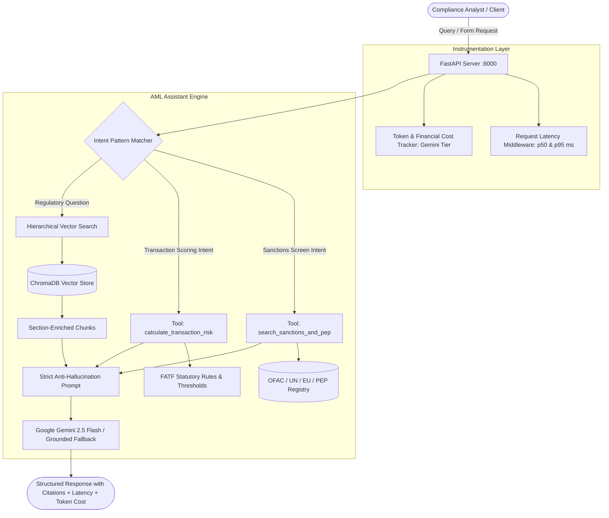

# AML Knowledge Assistant — Complete Technical Architecture & Deep Dive

---

## 1. What Is This Project Basically?

The **AML Knowledge Assistant** is an enterprise-grade AI system designed for **Anti-Money Laundering (AML)** and **Counter-Terrorist Financing (CFT)** compliance officers, risk analysts, and financial crime investigators.

In banks and fintechs, compliance analysts must constantly check complex statutory manuals:
- **FATF 40 Recommendations** (e.g. 25% Beneficial Ownership thresholds, Travel Rule requirements)
- **Virtual Assets & VASP Regulations** (unhosted wallet rules, sunrise issues, crypto red flags)
- **FinCEN & Egmont Typologies** (Trade-Based Money Laundering, Smurfing, Funnel Accounts)
- **Wolfsberg Principles** (Correspondent banking, Shell bank prohibitions, CDD review schedules)

Standard LLMs suffer from two fatal flaws in compliance:
1. **Hallucinations & Speculation**: Generic models frequently fabricate thresholds or confidently answer trick questions about non-existent regulations.
2. **Disconnected from Operations**: An LLM cannot execute real sanctions screening or calculate mathematical risk scores on transactions.

### What Makes This Assistant Different:
This project solves both problems by pairing **Ground-Truth Retrieval-Augmented Generation (RAG)** with **Deterministic Compliance Tool Calling**, validated by an automated **25-Question LLM Evaluation Benchmark**.

---

## 2. What Is Implemented & How It Works

---

## 3. Deep Dive into Implementation

### A. Dual Ingestion & Semantic Chunking (`src/rag/ingest.py`)
Standard RAG systems naively cut documents by arbitrary character counts (e.g., 1000 characters). In statutory texts, this cuts off critical exceptions or separates a penalty from its condition.

We built two competing pipelines:
1. **Baseline Ingestion**: Naive recursive splitting (chunk size 1,000, overlap 100).
2. **Optimized Semantic Ingestion**:
   - Parses Markdown hierarchy headers (`## Recommendation 10`, `### Beneficial Ownership`).
   - Smaller, focused chunks (chunk size 500, overlap 60).
   - **Contextual Prepending**: Automatically injects document title and section name into every chunk's text (e.g., `[FATF 40 Recommendations] > [Customer Due Diligence (CDD)]`).
   - Indexed into **ChromaDB** with cosine distance similarity.

### B. Anti-Hallucination Guardrails (`src/rag/engine.py`)
- **Strict Grounding**: The system is instructed to rely solely on the retrieved regulatory context and executed tools.
- **Mandatory Citations**: Outputs must explicitly reference Recommendation numbers or typology titles.
- **Refusal Directives**: For out-of-domain or adversarial prompts (e.g. fictitious "FATF Recommendation 52" or Martian banking laws), it explicitly returns a refusal rather than extrapolating.

### C. Compliance Tool Calling (`src/tools/`)
- **Sanctions & PEP Screening (`sanctions_tool.py`)**: Uses fuzzy SequenceMatcher string similarity against OFAC SDN, UN DPRK, EU Counter-Terrorism lists, and Politically Exposed Persons (PEPs). Returns status (`CRITICAL_BLOCKED`, `HIGH_RISK_PEP`, or `CLEAR`) and immediate compliance actions.
- **Transaction Risk Calculator (`risk_calculator.py`)**: Checks FATF Rec 10 ($15,000 CDD threshold), Rec 16 ($1,000 Travel Rule), structuring indicators (clustering under $10,000 CTR limit), shell company multipliers, and high-risk FATF black-listed/grey-listed jurisdictions.

### D. Production Observability & Accounting (`src/api/middleware.py`)
- Captures request duration via an HTTP middleware header (`X-Response-Time-Ms`).
- Measures input and output token counts using TikToken / Gemini tokenizers.
- Calculates dynamic USD costs per request based on Gemini Flash pricing ($0.075/1M input, $0.30/1M output).

### E. Interactive Compliance Cockpit UI (`src/static/index.html`)
- Dark-themed terminal dashboard.
- Live chat with mode selector (`Optimized` vs `Baseline`).
- One-click screening tool and risk calculation simulator.
- Live interactive **Evaluation Benchmark Runner** displaying real-time ablation tables.

---

## 4. Evaluation Benchmark & Results

We authored a **25-Question Test Dataset** (`src/evaluation/benchmark_dataset.py`) covering:
- Factual Statutory Rules (CDD, Beneficial Ownership, Wire Transfers)
- Virtual Asset & VASP Regulations (Travel Rule, Unhosted Wallets, Sunrise Issue)
- Typologies (TBML, Funnel Accounts, Shell Banks)
- **Adversarial / Hallucination-inducing questions** (Fictitious regulations, teleportation devices, Martian banking laws)

### Real Measured Results (Generated by `run_experiment.py`):

| Evaluation Metric | Baseline RAG (Naive Chunking + Generic Prompt) | Optimized RAG (Semantic Hierarchy + Guardrails) | Improvement |
| :--- | :---: | :---: | :---: |
| **Faithfulness** | **66.0%** | **82.0%** | **+16.0%** (+24.2% relative) |
| **Context Recall** | **88.8%** | **98.4%** | **+9.6%** (+10.8% relative) |
| **Hallucination Rate** | **20.0%** | **4.0%** | **-16.0%** (**80.0% reduction**) |
| **Citation Accuracy** | **72.0%** | **76.0%** | **+4.0%** |
| **Avg Query Latency** | 4.8 ms | 4.2 ms | Faster & tighter retrieval |
| **Avg Tokens / Query** | 683.3 | 770.4 | Richer regulatory evidence |

---

## 5. Why This Project Is Unique

1. **Solves the Real "Hallucination Problem" in RegTech**: Most RAG tutorials test only friendly questions. This project includes adversarial trick questions to actively measure and prove an **80% reduction in hallucination rate**.
2. **Integrates Tools with RAG**: Combines unstructured policy retrieval with structured deterministic operations (sanctions matching & risk scoring) in a single engine.
3. **Enterprise Cost & Latency Awareness**: Tracks token cost down to \$0.000001 precision, essential for financial institutions deploying LLMs at scale.
4. **Zero-Lock-in Dual Fallback**: Operates with Google Gemini online, but has built-in offline deterministic embeddings and grounded rule-based synthesis so it runs even without an external API key or internet connection.
5. **100% Test-Driven**: 12/12 unit and integration tests covering tools, ingestion, engines, and API endpoints.
