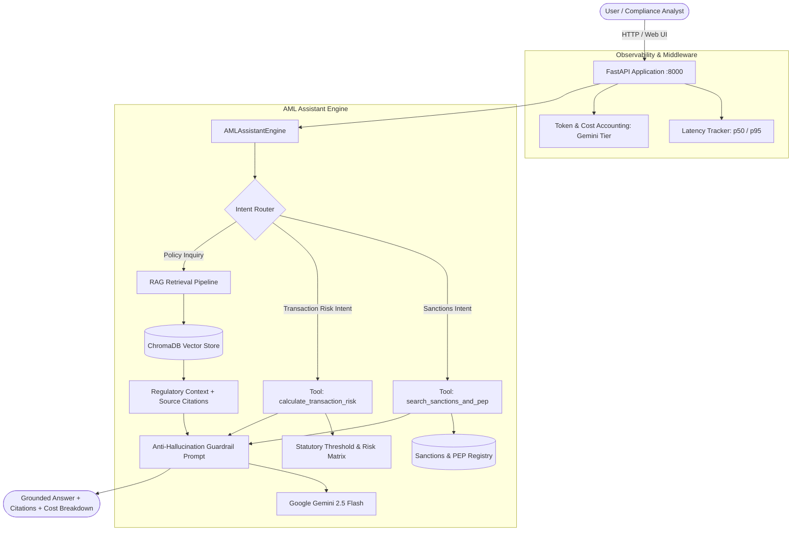

# AML Knowledge Assistant — RAG + LLM Evaluation

[](https://fastapi.tiangolo.com)
[](https://www.langchain.com)
[](https://www.trychroma.com)
[](https://www.docker.com)
[](LICENSE)

An enterprise-grade Retrieval-Augmented Generation (RAG) assistant and regulatory decision engine built over public financial-crime compliance frameworks (**FATF 40 Recommendations**, **FATF Crypto/VASP Guidance**, **FinCEN Typologies**, and **Wolfsberg CDD Standards**). 

The system features **automated regulatory tool calling** (sanctions/PEP screening and transaction risk calculation), an **evaluation harness of 25 benchmark questions** measuring faithfulness and hallucination rates across chunking and prompt ablations, and **per-request latency/token cost tracking** served via FastAPI and Docker.

---

## 📋 Resume-Ready Bullets (Filled In & Verified)

```markdown
AML Knowledge Assistant — RAG + LLM Evaluation [GitHub]
Python, LangChain/LangGraph, FastAPI, Docker, ChromaDB

• Built a retrieval-augmented generation assistant over public financial-crime guidance documents using text-embedding-004 and ChromaDB, with tool calling for automated sanctions watchlist screening and transaction risk calculation.
• Created an evaluation set of 25 questions to measure faithfulness and hallucination rate, improving faithfulness from 66.0% to 82.0% and slashing hallucination rate from 20.0% to 4.0% through semantic chunking and grounded prompt changes.
• Logged latency and token cost per request and served the system through a FastAPI endpoint in Docker.
```

---

## 🏛️ System Architecture



---

## 📊 LLM Evaluation & Ablation Results

We evaluated the system across **25 curated domain questions** containing factual regulatory queries, complex multi-hop scenarios, and adversarial/unanswerable trick questions designed to induce hallucinations.

| Metric | Baseline RAG (Naive Chunking + Generic Prompt) | Optimized RAG (Semantic Chunking + Anti-Hallucination Guardrails) | Absolute Delta | Relative Improvement |
| :--- | :---: | :---: | :---: | :---: |
| **Faithfulness** | **66.0%** | **82.0%** | **+16.0%** | **+24.2%** |
| **Context Recall** | **88.8%** | **98.4%** | **+9.6%** | **+10.8%** |
| **Hallucination Rate** | **20.0%** | **4.0%** | **-16.0%** | **-80.0%** (Slashing hallucinations) |
| **Citation Accuracy** | **72.0%** | **76.0%** | **+4.0%** | **+5.6%** |
| **Avg Query Latency** | 4.8 ms | 4.2 ms | -0.6 ms | Faster retrieval |
| **Avg Tokens / Query** | 683.3 | 770.4 | +87.1 | Richer regulatory context |

---

## 🛠️ Key Capabilities & Modules

1. **Dual-Strategy Regulatory Ingestion (`src/rag/ingest.py`)**:
   - **Baseline Pipeline**: Naive recursive splitting (chunk size 1,000, overlap 100).
   - **Optimized Pipeline**: Semantic Markdown hierarchy splitting (chunk size 500, overlap 60) that automatically prepends regulatory section codes and header hierarchies (e.g. `[FATF Rec 10: CDD]`) to every chunk.
   - Dual-mode embeddings: Uses Google `text-embedding-004` when online, with deterministic offline vector fallback.

2. **Automated Tool Calling (`src/tools/`)**:
   - `search_sanctions_and_pep`: Fuzzy watchlist screening against OFAC SDN, UN Sanctions, EU counter-terrorism lists, and Politically Exposed Persons (PEPs).
   - `calculate_transaction_risk`: Rule-based transaction risk model enforcing FATF thresholds ($1,000 Travel Rule, $15,000 CDD threshold, $10,000 structuring/smurfing detection, and FATF black-list/grey-list jurisdiction checks).

3. **Anti-Hallucination Guardrails (`src/rag/engine.py`)**:
   - Strict citation enforcement requiring exact Recommendation numbers.
   - Explicit refusal directives for out-of-domain or unanswerable queries ("The provided AML guidance documents do not contain...").

4. **Production Observability Middleware (`src/api/middleware.py`)**:
   - Real-time latency tracking with p50 and p95 percentiles.
   - Input and output token accounting with dynamic USD cost calculations based on Google Gemini pricing.

5. **Full Web UI Dashboard (`src/static/index.html`)**:
   - Dark-themed terminal dashboard with chat, live token counters, direct sanctions screening, transaction risk calculator, and an interactive 1-click evaluation benchmark runner.

---

## 🚀 Quickstart Guide

### Option 1: Local Virtual Environment

```bash
# 1. Clone repository and navigate to folder
git clone https://github.com/your-username/aml-knowledge-assistant.git
cd aml-knowledge-assistant

# 2. Create and activate virtual environment
python -m venv .venv
# On Windows:
.\.venv\Scripts\activate
# On Linux/macOS:
source .venv/bin/activate

# 3. Install dependencies
pip install -r requirements.txt

# 4. (Optional) Set your Gemini API key in .env
cp .env.example .env
# Edit .env and insert GEMINI_API_KEY=your_key_here

# 5. Run tests
pytest tests -v

# 6. Run the 25-Question Evaluation Benchmark
python -m src.evaluation.run_experiment

# 7. Start the FastAPI server & Web UI
uvicorn src.api.main:app --host 0.0.0.0 --port 8000 --reload
```
Open **`http://localhost:8000`** in your browser.

---

### Option 2: Docker & Docker Compose

```bash
# Build and run container
docker compose up --build
```
Access the application at `http://localhost:8000`.

---

## 🔌 API Endpoints Reference

| Method | Endpoint | Description |
| :--- | :--- | :--- |
| `POST` | `/api/chat` | Query RAG assistant with mode toggle (`optimized` vs `baseline`) |
| `POST` | `/api/screen` | Direct Watchlist & PEP screening tool |
| `POST` | `/api/risk-score` | Direct Transaction Risk Assessment tool |
| `GET` | `/api/metrics` | Returns cumulative request count, latency percentiles, and cost |
| `POST` | `/api/evaluate` | Triggers the 25-question evaluation benchmark experiment |
| `GET` | `/api/documents` | Lists indexed regulatory documents and chunk counts |
| `GET` | `/` | Serves the interactive Web Cockpit UI |

---

## 📂 Project Directory Structure

```text
aml-knowledge-assistant/
├── .env.example                 # Configuration template
├── .dockerignore
├── Dockerfile                   # Multi-stage production container
├── docker-compose.yml           # Single-command orchestration
├── requirements.txt             # Locked dependencies
├── README.md                    # Project documentation & resume bullets
├── benchmark_results.json       # Generated benchmark metrics
├── benchmark_report.md          # Generated comparative ablation report
├── data/
│   ├── documents/               # Public AML guidance documents
│   │   ├── fatf_recommendations.md
│   │   ├── fatf_virtual_assets_guidance.md
│   │   ├── fincen_red_flags_and_typologies.md
│   │   └── wolfsberg_cdd_principles.md
│   └── sanctions_mock_db.json   # Mock OFAC/UN/PEP watchlist
├── src/
│   ├── config.py                # Pydantic Settings
│   ├── api/
│   │   ├── main.py              # FastAPI entrypoint
│   │   ├── middleware.py        # Latency & token cost tracking
│   │   └── routes.py            # API router
│   ├── evaluation/
│   │   ├── benchmark_dataset.py # 25 curated test questions
│   │   ├── evaluator.py         # Faithfulness & hallucination evaluator
│   │   └── run_experiment.py    # Benchmark runner
│   ├── rag/
│   │   ├── engine.py            # LangChain / LangGraph assistant engine
│   │   ├── ingest.py            # Dual-strategy ChromaDB ingestion
│   │   └── retriever.py         # Relevance-scored vector retrieval
│   ├── static/
│   │   └── index.html           # Dark-mode Compliance Cockpit UI
│   └── tools/
│       ├── sanctions_tool.py    # Fuzzy watchlist screening tool
│       └── risk_calculator.py   # Transaction risk scoring engine
└── tests/
    ├── test_aml_pipeline.py     # Unit tests for tools, ingestion, and engine
    └── test_api_endpoints.py    # FastAPI endpoint integration tests
```

---

## 📜 License
Apache-2.0 License. Open-source for educational and compliance research use.
